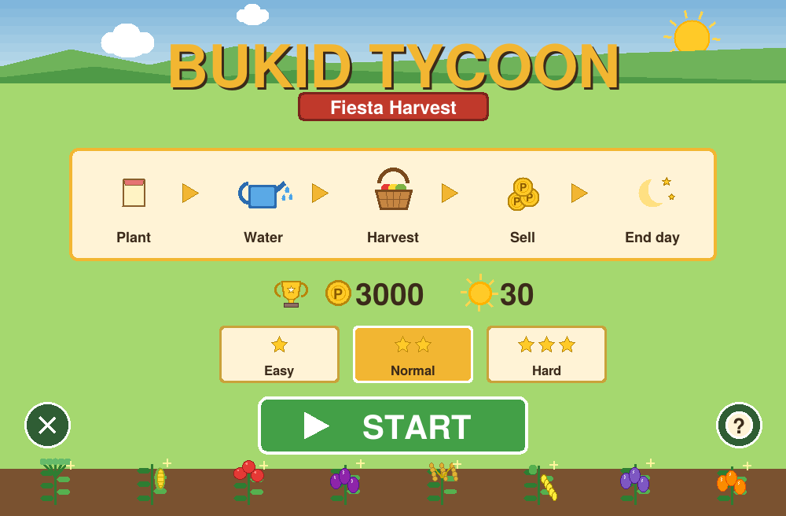
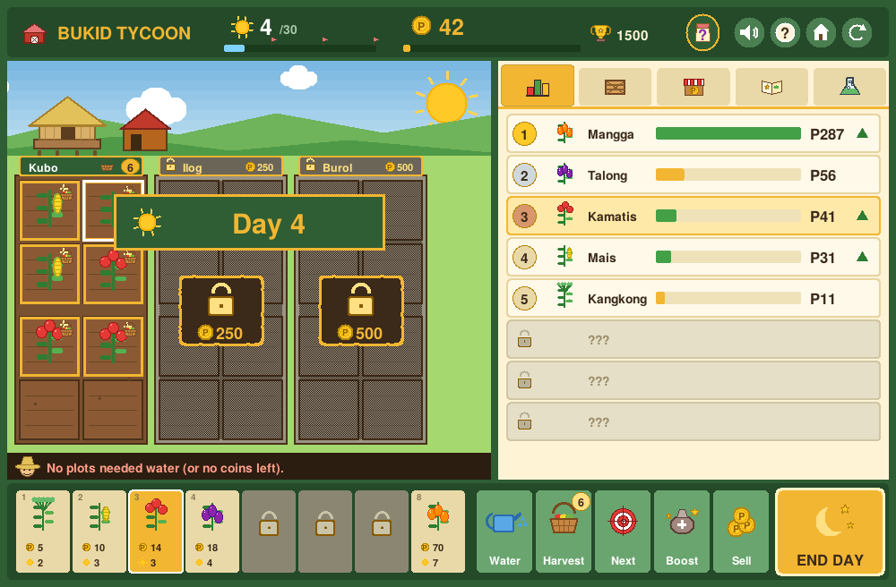
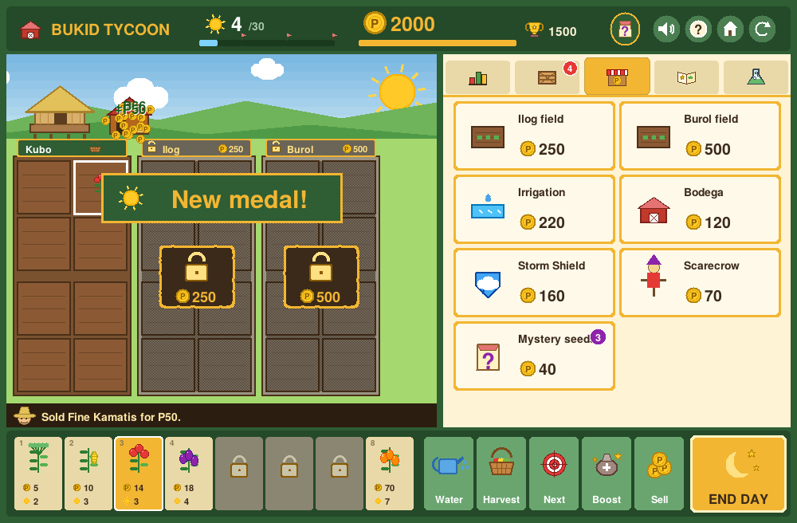
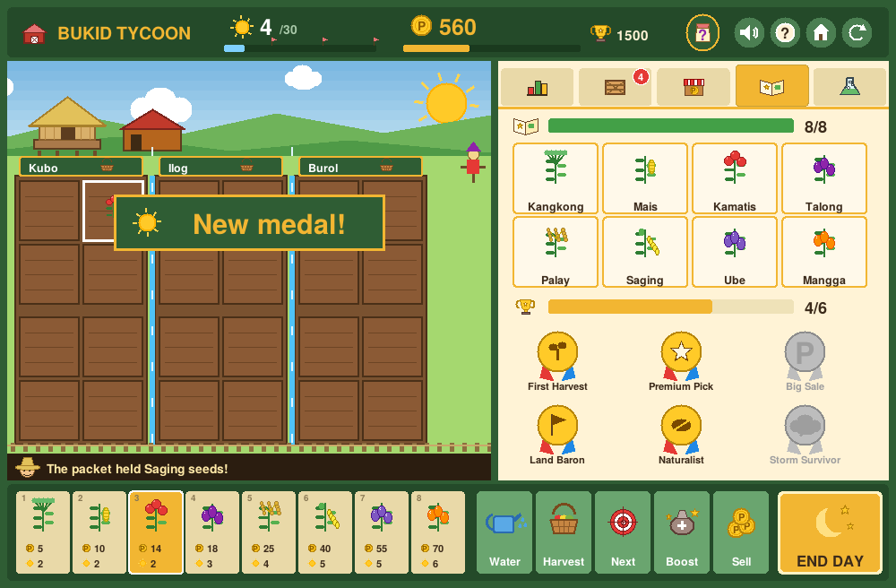
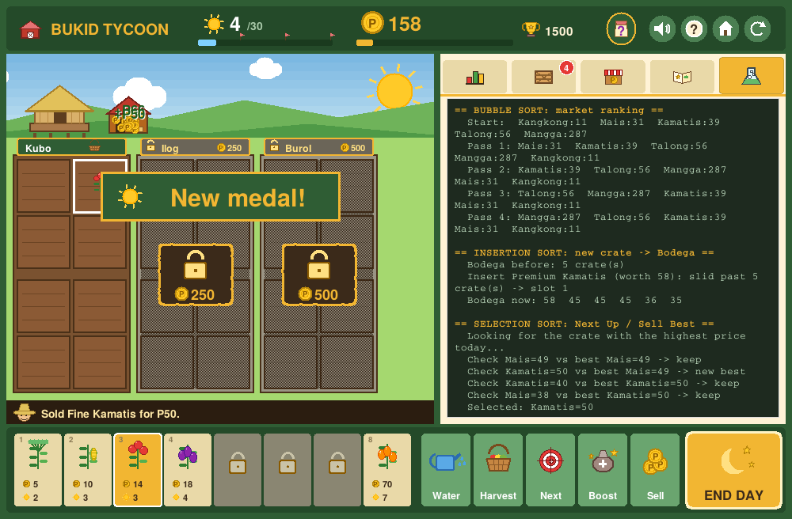
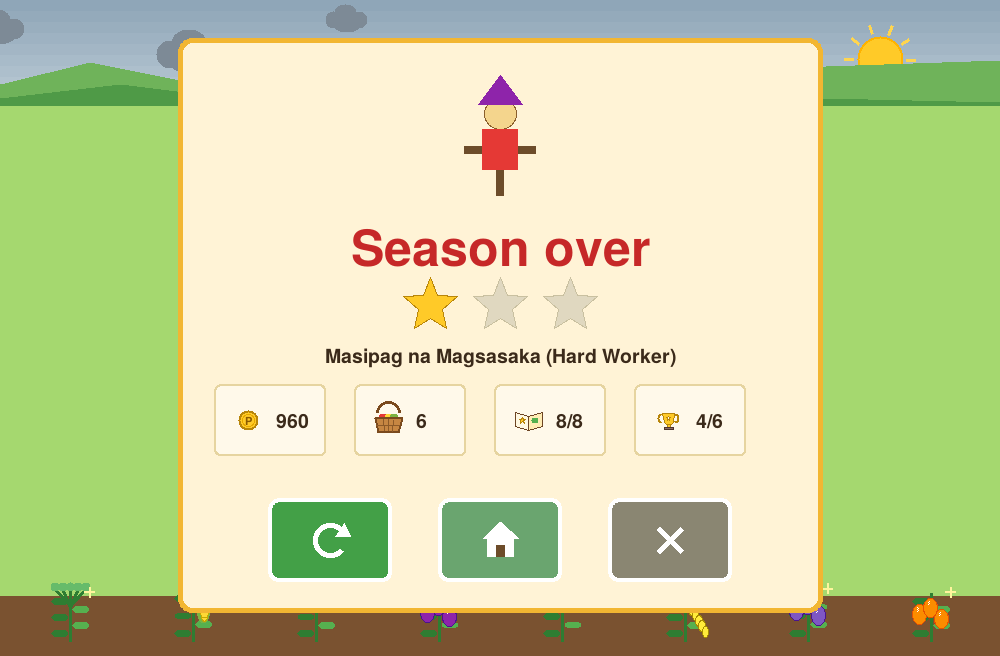

# Bukid Tycoon: Fiesta Harvest

A farm-management game made with **Python + Tkinter** (picture-based interface with sound effects) for the Python Game Development Midterm Lab Exam (**Group 2: Farm Tycoon**).

You run a small barangay farm for **30 days**. Plant crops, water them, harvest, sell at a changing market, expand your land and reach the coin goal before the season ends. Fiesta days pay extra, but typhoons and pests can ruin your plans.

  

---

## Screenshots

| Start screen | Farm with crops ready |
|---|---|
|  |  |

| Shop (pictures only) | Journal: crops and medals |
|---|---|
|  |  |

| Algo Lab (sorting steps + recursion) | End screen |
|---|---|
|  |  |

---

## Game objective

Earn the **goal amount of coins within 30 days**:

| Difficulty | Goal |
|---|---|
| Easy | P1,500 |
| Normal | P3,000 |
| Hard | P4,500 |

* **Win:** your coins reach the goal (the game ends right away with a victory screen).
* **Loss:** Day 30 ends and you are below the goal.
* After either ending you can **Play Again**, return to the **Main Menu**, or **Exit**.

## Rules

1. **Plant.** Pick a seed in the bottom bar, then click an empty plot. Seeds cost coins.
2. **Water.** Click a growing crop to water it (P2). A blue drop on the plot means it is thirsty. The more days a crop is watered while it grows, the better its quality (**Normal, Fine, Premium**) and the more it sells for.
3. **Harvest.** A crop is ready when all its growth dots are filled (the plot glows gold with a basket); click it. Each harvest makes one **crate** in your **Bodega** (storage). The Bodega has limited space.
4. **Sell.** Crates sell at **today's market price**. Every crate you sell lowers that crop's price a little, so sell a mix. Prices drift back to normal each day.
5. **End the day.** Plants grow, prices move, and a random event may happen: rain, typhoon, pests, market glut, high demand, mayor's gift, or a seed swap.
6. **Barangay Fiesta** on days **10, 20 and 30**: everything sells for **+50%**.
7. **Expand.** In the Shop you can buy two more fields and four upgrades (Irrigation, Bodega, Storm Shield, Scarecrow), or open a **Mystery Seed Packet** to discover a new crop (8 crops in total).
8. Unlock **6 achievements** and fill your **Crop Journal**.

## Controls

| Input | Action |
|---|---|
| Click a plot | **Smart click**: plants the chosen seed on an empty plot, waters a thirsty crop, harvests a ready crop |
| Hold and **drag** over plots | Does the same on many plots at once |
| Seed pictures (bottom bar) or keys `1`-`8` | Choose which crop to plant |
| Click a **field name bar** (above the plots) | Harvest that whole field (or buy it when locked; click the padlock) |
| `B` / Boost button | Boost mode: click a growing crop to grow it one day (P25) |
| `M` / speaker button | Sound on or off |
| `?` / help button | Picture help screen |
| `A` | Water all planted plots |
| `H` | Harvest all ready plots |
| `S` | Sell the most valuable crate right now |
| `N` | "Next Up": highlight the crop that will finish soonest |
| `Space` | End the day |
| Picture tabs on the right | Market (chart), Bodega (crate), Shop (stall), Journal (book), **Algo Lab** (flask) |
| Home / Restart buttons (top right) | Back to start screen / start a new run |
| `Esc` | Main menu |

## Team members and roles

> Replace the names below before submitting.

| Member | Primary role | Main code contribution |
|---|---|---|
| _Stefe Kira R. Albarece_ | Team coordinator and integrator | `main.py`, `game.py` (`end_day`, events, `new_game`), merging and full-game testing |
| _Antonette Hian Serato_ | Gameplay programmer | `game.py` (plant, water, harvest, sell, shop rules, win/loss) |
| _Diane Beatrice Al Kasem_ | Data structures and algorithms programmer | `algorithms.py` (3 sorts), `zones.py` (recursion), game features that call them |
| _Trisha Mae Poligrates_ | Interface and asset designer | `ui.py` (screens, controls, feedback), `icons.py` (all pictures), `sounds.py` (sound effects) |
| _Pepito Sia III_ | QA, documentation and release lead | `tests/`, `tools/`, README, feature map, GitHub release, achievements and rank feature |

(For a 4-person team, the coordinator also takes the QA / documentation / release duties.)

## Framework and Python version

* **Framework:** Tkinter (included with Python; no `pip install` needed)
* **Python:** 3.8 or newer (developed and tested on 3.12)

## Setup and launch

```bash
# 1. Get the code
git clone <YOUR-REPO-URL>
cd bukid-tycoon

# 2. Run the game
python main.py          # Windows: python main.py    |  macOS/Linux: python3 main.py
```

If you see `No module named tkinter`:

* **Ubuntu / Debian:** `sudo apt install python3-tk`
* **Windows / macOS:** reinstall Python from python.org (Tkinter is included by default).

There are **no external packages** (see `requirements.txt`), **no image files and no audio files**: every picture is drawn with code on the Tkinter canvas and every sound effect is generated by code (`sounds.py`).

**Sound:** works out of the box on Windows (built-in `winsound`) and macOS (`afplay`). On Linux it uses `paplay`, `aplay` or `play` if installed. If your computer cannot play sound, the game just stays silent. Press `M` to mute.

## Run the tests

```bash
python -m unittest discover -s tests -v      # 112 unit tests (no window needed)
python tools/simulate.py 200                  # balance check: bots play 200 seasons
xvfb-run -a python tools/ui_smoke.py          # optional: clicks the real buttons and plays a season (Linux)
```

## Where are the required course concepts?

See **[FEATURE_MAP.md](FEATURE_MAP.md)** for exact files and functions. Short version:

| Concept | Used for |
|---|---|
| Bubble Sort | Ranks crops by selling price on the Market board |
| Insertion Sort | Slides every harvested crate into its place in the ordered Bodega |
| Selection Sort | "Next Up" finds the crop with the lowest growth time left; "Sell Best" finds the highest-priced crate |
| Tuple | Plot coordinates `(row, col)`, ranking pairs `(crop, price)`, field column ranges |
| Set | Discovered crops, unlocked achievements, owned fields, bought upgrades |
| Dictionary | Crop data, plots, price index, crate counts, events, upgrades |
| Recursion | Walks the nested farm (farm, field, bed) to find and total ready harvests; base case = a bed with no children |

The **Algo Lab** tab in the game shows the sorting steps and the recursion report live.

## Project structure

```
bukid-tycoon/
├── main.py            start the game
├── ui.py              Tkinter screens, clicks and layout (no game rules)
├── icons.py           every picture, drawn with canvas shapes
├── sounds.py          sound effects made with code + the player
├── game.py            all game rules and state (no Tkinter)
├── algorithms.py      Bubble, Insertion and Selection Sort (written by us)
├── zones.py           farm tree + recursive functions
├── data.py            crops, prices, upgrades, events, settings
├── docs/              screenshots used in this README
├── tests/             unit tests for sorts, recursion and game rules
├── tools/             balance simulator and UI smoke test
├── FEATURE_MAP.md     where every course concept appears
├── TESTING.md         test plan, results and bug log
├── TEAM_GUIDE.md      roles, commit plan and defense preparation
├── CREDITS.md         credits and licenses
└── requirements.txt   (no external packages)
```

## Demonstration Video
[DEMO] (docs/bukid-tycoon-demo.mp4)

## Credits

See [CREDITS.md](CREDITS.md). All art and sound is original and generated by code; crop names are Filipino.
